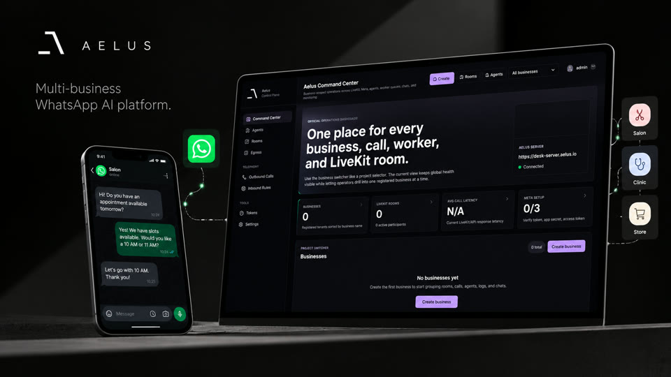
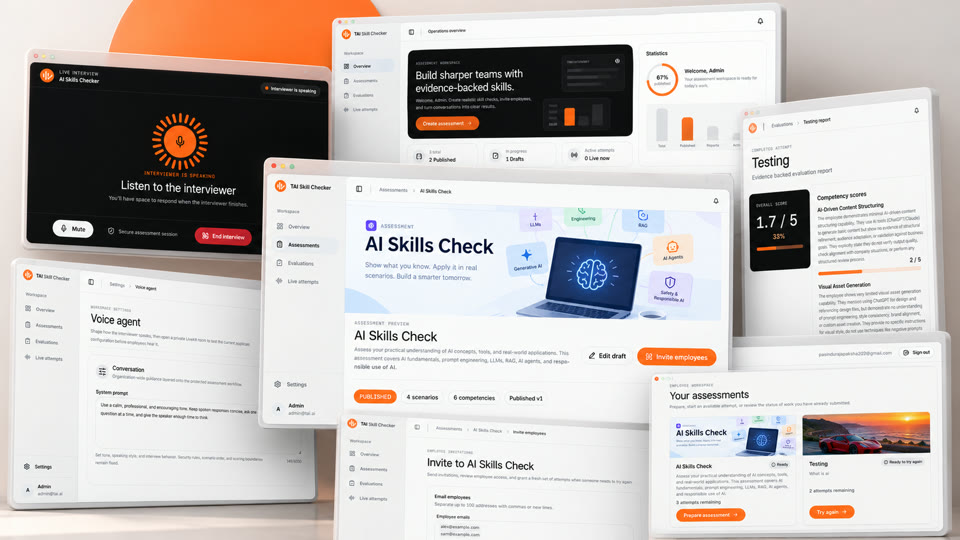
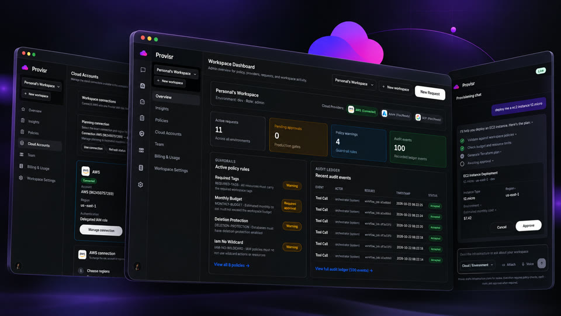
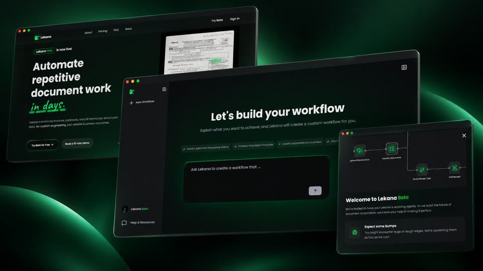
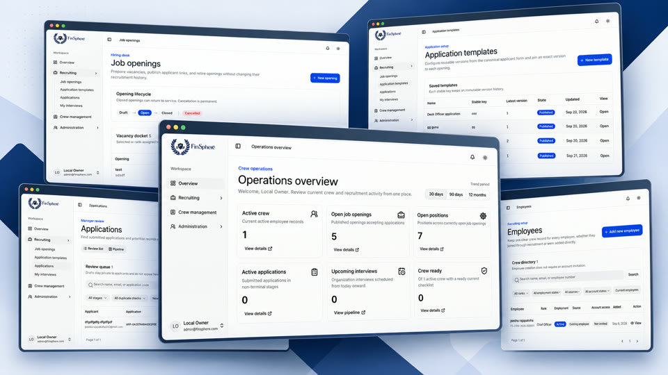
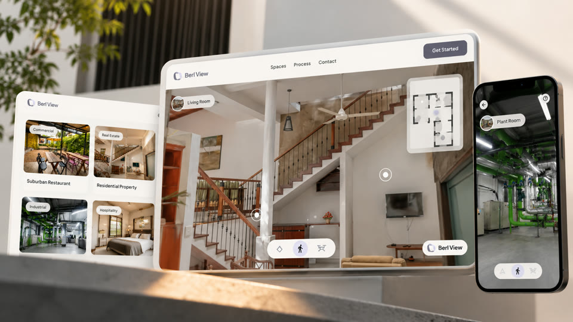
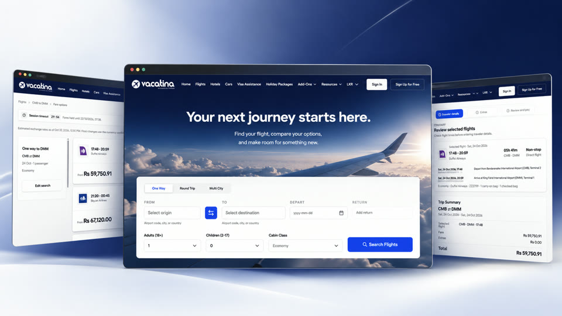
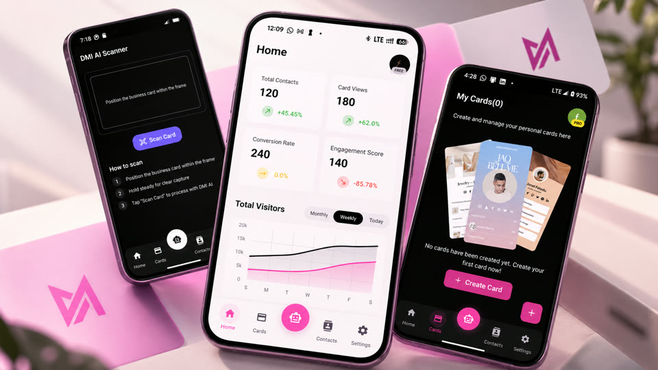
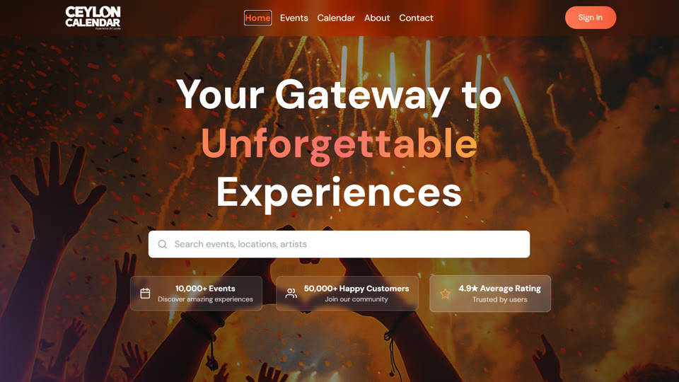

# Hi, I'm Pasidu 👋

**Software engineer building AI products and the production systems around them.**

Real-time voice agents · WhatsApp AI agents · document AI pipelines · multi-cloud infrastructure

---

I take products from the first client conversation through architecture, APIs, databases, CI/CD and deployment, then put AI inside them. I care about **AI that works in production, not just in demos**: isolated tenants, queues for slow work, durable state, and failures that stay contained to one stage.

- 🏗️ Building **Provisr**, a multi-cloud provisioning platform, mentored by a Sysco Labs Technical Lead
- 🚀 Previously **Co-Founder & Software Engineer at Zybbera (Pvt) Ltd**, delivering client projects end to end
- 🎓 BSc Information Systems at the **University of Colombo** (3rd year, Dean's List) · Web Master, ACM Student Branch
- 📍 Colombo, Sri Lanka (GMT+5:30)

> [!NOTE]
> **Why this profile looks quiet:** most of my work was built for clients and organizations, so the code lives in private or organization repositories. The projects below are real, shipped or in active development. Full case studies with screenshots, architecture diagrams and request flows are on **[my portfolio](https://pasidurajapaksha.site/#work)**, and I'm happy to walk through any of them in an interview.

---

## 🛠️ Selected work

<table>
<tr>
<td width="50%" valign="top">

### Aelus Desk
**Multi-business WhatsApp AI platform** · Architecture & full-stack · 2025

One deployment serves many businesses on WhatsApp: AI text agents with tool calling and knowledge search, plus real-time AI voice calls.

- Transactional outbox → BullMQ, so a failed publish never drops a message
- Debounced turns under a renewable Redis lock, so AI replies never overlap
- WhatsApp calls bridged into LiveKit, answered by a Python agent on Gemini Realtime
- HMAC-SHA256 signed webhooks; configurable LLM provider via the Vercel AI SDK

`TypeScript` `Express` `LiveKit` `Gemini Realtime` `PostgreSQL` `Redis` `BullMQ`
</td>
<td width="50%" valign="top">

### TAI Skill Checker
**Voice AI skill assessments** · Full-stack & voice AI · Tai Labs · 2026

An AI interviewer runs realistic, scenario-based voice skill checks with employees and turns each conversation into an evidence-backed report.

- AI voice interviewer conducting scenario-based assessments
- Listen-only live inspection with a rolling transcript
- Attempt reports and an evaluation queue for reviewers

`Voice AI` `LiveKit` `AI Agents` `Next.js`
</td>
</tr>
<tr>
<td width="50%" valign="top">

### Provisr
**Multi-cloud provisioning** · Engineering · 🟢 In progress · 2026

Provision infrastructure across cloud providers from one place. Built under mentorship from a Sysco Labs Technical Lead.

- One workspace for all connected cloud accounts
- Policy rules and monthly budgets per workspace
- Audit trail of provisioning events

`TypeScript` `Python` `Go`
</td>
<td width="50%" valign="top">

### Lekana.dev
**AI document automation** · Full-stack & AI pipeline · Beta, live · 2025

Turns invoices, contracts and HR forms into structured data, with no custom engineering per document type.

- Field-by-field extraction from scanned and handwritten forms
- OCR, classification and validation as independent services
- Built for high-volume, fault-tolerant processing

`Next.js` `Python` `FastAPI` `Node.js`
</td>
</tr>
<tr>
<td width="50%" valign="top">

### Finsphere CrewOps
**Maritime recruitment & crew management** · Full-stack · Production · 2025

Digitizes seafarer recruitment, document compliance and onboarding in a Turborepo monorepo.

- Applicant tracking through to onboarding
- Document compliance checks
- Role-based access control enforced in the backend, not the UI

`Next.js` `NestJS` `PostgreSQL` `Prisma` `Better Auth`
</td>
<td width="50%" valign="top">

### Berl View
**3D Gaussian Splatting walkthroughs** · Pipeline & web viewer · Delivered · 2025

Turns on-site captures of plant rooms and facilities into photoreal 3D scenes you can walk through in the browser.

- Capture-to-scene Gaussian Splatting pipeline
- Browser viewer with walk, orbit and plan modes
- Remote, photoreal inspection of real facilities

`3D Gaussian Splatting` `WebGL` `Python`
</td>
</tr>
<tr>
<td width="50%" valign="top">

### Vacatina Flights
**Flight search & booking** · Full-stack · Delivered · 2025

Travel booking site with live airline inventory and checkout.

- Live fares through the Duffel API
- One-way, round-trip and multi-city search
- PayPal checkout and multi-currency pricing

`Next.js` `Duffel API` `PayPal`
</td>
<td width="50%" valign="top">

### DMI Cards
**Digital business card app** · Mobile development · Delivered · 2025

Flutter app for creating and sharing digital business cards.

- Shareable digital cards and AI card scanning
- Contact capture and management
- Analytics on views, conversions and engagement

`Flutter` `Dart`
</td>
</tr>
<tr>
<td width="50%" valign="top">

### Ceylon Calendar
**Event discovery for Sri Lanka** · Full-stack · Delivered · 2025

Concerts, festivals and experiences across the island in one searchable place.

- Search by event, location or artist
- Calendar view of upcoming events
- User accounts and sign-in

`Next.js` `Node.js` `PostgreSQL`
</td>
<td width="50%" valign="top">

### Sanasa Life: Document AI
**Insurance document intelligence** · AI engineering · 2024

Replaced a manual sorting step for scanned insurance documents.

- Extraction with GCP Document AI
- Classification with LangChain
- Embedding-based duplicate detection and automated routing

`Python` `LangChain` `GCP Document AI`

### Sanasa Life: Customer Portal
**Internship** · 2023 – 2024

Owned the portal end to end: auth, invoices, quotations, notifications and dashboards.

`React` `Node.js` `Oracle DB`

**Also built:** Fuze (event ticketing), SWA App, New Path (Java)
</td>
</tr>
</table>

**[→ See full case studies on my portfolio](https://pasidurajapaksha.site/#work)**

---

## 💼 Experience

| Role | Organization | When |
| --- | --- | --- |
| Engineer, Provisr (mentored) | with a Sysco Labs Technical Lead | 2026 – present |
| Co-Founder & Software Engineer | Zybbera (Pvt) Ltd | Jun 2024 – Dec 2025 |
| Software Developer Intern | Sanasa Life Insurance Co. PLC | Nov 2023 – Mar 2024 |

---

## 🧰 Tech stack

**AI engineering:** AI agents · voice AI · RAG · LangChain · LLM tool calling · embeddings & vector search · OCR / Document AI · Gemini & Gemini Realtime · Vercel AI SDK · LiveKit

  

  

  

  

---

**Open to conversations about AI engineering, full-stack and platform roles.**
Email is the fastest way to reach me: **[pasindurajapaksha202@gmail.com](mailto:pasindurajapaksha202@gmail.com)**

